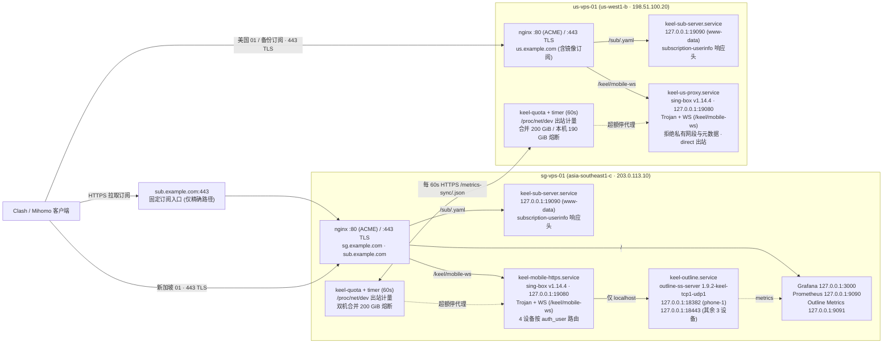

# Keel 双节点 443 TLS 架构与运维手册（2026-11-24）

本文档记录 `2026-11-24` 已在生产环境部署并端到端验证通过的双节点 `443` TLS（Trojan + WebSocket）架构、DNS 拓扑、统一 Clash 订阅结构、月度流量计量与自动熔断机制以及日常运维规范。所有真实密钥、Trojan 密码与 256-bit 随机路径（订阅与指标同步）仅保存在各 VPS 本机受限文件中，严禁写入 Git。

> 配套脱敏配置模板位于 [`deploy/tls-gateway/`](../deploy/tls-gateway/)。新建独立账号或查看旧版单机 Outline 安装流程见[接入与安装手册](./agent-onboarding.md)。

## 1. 故障背景与升级摘要

- **触发事件**：`2026-11-23 19:41 UTC`（北京时间 `2026-11-24 03:41`），原新加坡主力机公网 IP `203.0.113.9` 因裸 Shadowsocks（`18443`）高频 TCP 流量触发 IP 级 TCP 封锁（全端口 TCP 回程 SYN-ACK 被丢弃，UDP 未受影响）。
- **核心生产升级**：
  1. **新加坡主力机全设备收敛至 443 TLS**：`sg-vps-01` 更换新外部 IP 为 `203.0.113.10`，将 `443` TLS（Trojan + WebSocket）入口从单设备扩展为支持全部 4 台设备（`computer-1`、`phone-1`、`computer-2`、`phone-2`），通过 `auth_user` 路由至本机回环 Outline，保留现有密钥与 Grafana 按设备流量/TCP 链路监控。
  2. **新增美国低成本备用机**：在俄勒冈部署 `us-vps-01`（GCP `e2-micro` Always Free 规格 + `STANDARD` 网络层级前 200 GiB／月免出站流量费），仅开放纯 `443` TLS 入口，不暴露任何明文／裸代理端口。
  3. **独立域名与 90 天常规证书**：引入域名 `example.com`（自定义权威 DNS），从 6 天短期 IP 证书（`keel-outline`）全面升级为 90 天常规 Let's Encrypt ECDSA 域名证书（当前到期 `2027-02-22`）。
  4. **统一双节点「机场式」Clash 订阅**：两机镜像托管 `/var/lib/keel-sub/profile.yaml`，客户端仅看到 `新加坡 01` 与 `美国 01` 两个逻辑节点，内置故障转移（新加坡优先）、自动测速与 134 条分流规则，并轮换为全新 256-bit 随机订阅路径（旧 IP 路径作废）。
  5. **月度出站流量计量、Clash 流量条与自动熔断**：两机统一部署 `keel-quota`（60 秒周期读取 `/proc/net/dev` 出站字节并跨节点同步）与 `keel-sub-server`（回环 `127.0.0.1:19090` 实时下发 Clash `subscription-userinfo` 与 `profile-update-interval: 12` 响应头），实现双机合并 `200 GiB／月`（美国本机额外 `190 GiB／月`）硬性熔断及每月 1 日 `00:00 UTC` 自动恢复。

## 2. 基础设施与 DNS 拓扑

- **GCP 项目**：`your-gcp-project-id`
- **域名与权威 DNS**：`example.com`（你的权威 DNS 服务商）

| 域名 | 记录类型 | 当前目标 IP | 用途与切换策略 |
| --- | --- | --- | --- |
| `sg.example.com` | `A` | `203.0.113.10` | 新加坡主力节点（Trojan-WS 入口 + Grafana 监控面板 + 跨节点流量同步端点） |
| `sub.example.com` | `A` | `203.0.113.10` | 固定订阅入口；新加坡维护或故障时可将 A 记录切至美国 IP，实现零客户端改动切换 |
| `us.example.com` | `A` | `198.51.100.20` | 美国备用节点（Trojan-WS 入口 + 镜像订阅备份入口 + 跨节点流量同步端点） |



### 2.1 节点 A：`sg-vps-01`（主力节点）

- **区域与规格**：`asia-southeast1-c`，Debian 13，`e2-medium`（2 vCPU / 4 GB RAM / 10 GB 启动盘）
- **网络地址**：公网 IP `203.0.113.10`（临时地址），内网 IP `10.148.0.2`
- **变更前快照**：`/var/backups/keel-ip-migrate-20261124/`

| 组件 / 服务 | 二进制与版本 | 关键配置路径与权限 | 监听与行为摘要 |
| --- | --- | --- | --- |
| `nginx` | Debian 软件包 | `/etc/nginx/sites-available/keel` | `:80` 仅开放 `/.well-known/acme-challenge/`（`/var/www/keel-acme`），其余 `404`；`:443` `sg.example.com` 反代 `/keel/mobile-ws` → `127.0.0.1:19080`、精确匹配 `/sub/<256-bit-token>.yaml` → `127.0.0.1:19090`（`keel-sub-server`，关闭 `access_log`，返回 `Cache-Control: private, no-store`、`X-Robots-Tag: noindex, nofollow` 及实时 `subscription-userinfo`）、精确匹配 `/metrics-sync/<256-bit-token>.json` 供对端同步月度用量、`/` → Grafana (`127.0.0.1:3000`)；`:443` `sub.example.com` 仅开放精确匹配订阅路径，其余（含 `/`）一律 `404`。 |
| `keel-mobile-https.service` | `/opt/keel-mobile/bin/sing-box` `v1.14.4` | `/etc/keel-outline/mobile-gateway.json`（`0600`） | 仅监听 `127.0.0.1:19080`，`trojan` + `ws`（`/keel/mobile-ws`），配置 4 个用户（`computer-1`、`phone-1`、`computer-2`、`phone-2`）。通过 `route.rules` 按 `auth_user` 路由至本机 Outline `shadowsocks` 出站：`phone-1` → `127.0.0.1:18382`，其余 → `127.0.0.1:18443`。systemd 施加 `IPAddressDeny=any` + `IPAddressAllow=localhost`。 |
| `keel-outline.service` | `/usr/local/bin/outline-ss-server` `1.9.2-keel-tcp1-udp1` | `/etc/keel-outline/server.yaml`（`0600`） | 保持原有设备密钥与端口不变，指标地址 `127.0.0.1:9091/metrics`，继续为 Grafana 提供按 `access_key` 分设备统计与 TCP 链路诊断指标。 |
| `keel-quota.timer` / `keel-quota.service` | `/usr/local/bin/keel-quota` | `/etc/keel-quota/config.json`（`0600`）、`/var/lib/keel-quota/` | 每 `60s` 读取默认网卡 `/proc/net/dev` 出站字节、拉取美国节点 `/metrics-sync/<256-bit-token>.json` 并计算双机合并用量；达到 `200 GiB／月` 时仅停止 `keel-mobile-https` 与 `keel-outline`，每月 1 日 `00:00 UTC` 自动清零并恢复。 |
| `keel-sub-server.service` | `/usr/local/bin/keel-sub-server` | `/var/lib/keel-sub/profile.yaml`、`/var/lib/keel-quota/` | 以 `www-data` 仅监听 `127.0.0.1:19090`，由 nginx 精确订阅路径反代，实时输出 `subscription-userinfo` 与 `profile-update-interval: 12`。 |
| `grafana-server` / `prometheus` | 官方软件包 | `/etc/systemd/system/grafana-server.service.d/keel.conf` | `GF_SERVER_ROOT_URL=https://sg.example.com/`；Grafana 监听 `127.0.0.1:3000`，Prometheus 监听 `127.0.0.1:9090`。 |
| `keel-cert-renew.timer` | `/opt/keel-certbot/bin/certbot` `v5.10.0` | 证书名 `keel-domain` | 已从原 6 天 IP 证书 `keel-outline` 切换为 90 天常规 ECDSA 域名证书（SAN：`sg.example.com`、`sub.example.com`，到期 `2027-02-22`）；旧 IP 证书已删除，已完成 `certbot renew --dry-run` 验证。 |

### 2.2 节点 B：`us-vps-01`（低成本备用节点）

- **区域与规格**：`us-west1-b`（俄勒冈），Debian 13，`e2-micro`（1 GB RAM / 30 GB `pd-standard` 标准盘），网络层级 `STANDARD`（前 200 GiB／月免出站流量费）
- **网络地址**：公网 IP `198.51.100.20`（临时地址），内网 IP `10.138.0.2`
- **防火墙标签**：`http-server,https-server`（对外仅放行 `tcp:80`、`tcp:443` 及默认 SSH，**不暴露任何明文或裸代理端口**）
- **系统优化**：
  - TCP BBR：`/etc/sysctl.d/90-keel-bbr.conf`
  - 日志限额：`/etc/systemd/journald.conf.d/size.conf`（`SystemMaxUse=100M`）
- **轻量化原则**：不部署 Prometheus / Grafana，将内存留给 `nginx`、`sing-box`、`keel-sub-server` 与周期性 `keel-quota`。

| 组件 / 服务 | 二进制与版本 | 关键配置路径与权限 | 监听与行为摘要 |
| --- | --- | --- | --- |
| `nginx` | Debian 软件包 | `/etc/nginx/sites-available/keel` | `:80` 仅用于 ACME HTTP-01；`:443`（`us.example.com`）反代 `/keel/mobile-ws` → `127.0.0.1:19080`、精确匹配 `/sub/<256-bit-token>.yaml` → `127.0.0.1:19090`（`keel-sub-server` 镜像提供统一订阅与实时流量条响应头）、精确匹配 `/metrics-sync/<256-bit-token>.json` 供新加坡节点拉取本机月度用量，其余路径一律 `404`。 |
| `keel-us-proxy.service` | `/opt/keel-mobile/bin/sing-box` `v1.14.4` | `/etc/keel-us/proxy.json`（`0600`）、`/etc/keel-us/inventory.json`（`0600`） | 仅监听 `127.0.0.1:19080`，`trojan` + `ws`（`/keel/mobile-ws`），出站 `direct`。路由首条规则 `{"ip_is_private": true, "action": "reject"}`，阻断内网网段与 `169.254.169.254` 云元数据访问。 |
| `keel-quota.timer` / `keel-quota.service` | `/usr/local/bin/keel-quota` | `/etc/keel-quota/config.json`（`0600`）、`/var/lib/keel-quota/` | 每 `60s` 读取默认网卡 `/proc/net/dev` 出站字节并拉取新加坡节点 `/metrics-sync/<256-bit-token>.json`；双机合并上限 `200 GiB／月` 且额外设本机 `190 GiB／月` 硬上限（严守 GCP Standard Tier 200 GiB 免费额度），超额仅停止 `keel-us-proxy`，每月 1 日 `00:00 UTC` 自动重置并拉起。 |
| `keel-sub-server.service` | `/usr/local/bin/keel-sub-server` | `/var/lib/keel-sub/profile.yaml`、`/var/lib/keel-quota/` | 以 `www-data` 仅监听 `127.0.0.1:19090`，由 nginx 精确订阅路径反代，实时输出 `subscription-userinfo` 与 `profile-update-interval: 12`。 |
| `keel-cert-renew.timer` | `/opt/keel-certbot/bin/certbot` `v5.10.0` | 证书名 `keel-us-domain` | 90 天常规 ECDSA 域名证书（SAN：`us.example.com`，到期 `2027-02-22`），已通过 `certbot renew --dry-run` 验证。 |

## 3. 统一 Clash 订阅与分流结构

两台主机镜像维护同一份 `/var/lib/keel-sub/profile.yaml`（权限仅允许 root 与 `www-data` 读取，例如 `0640`）：

- **主订阅入口**：`https://sub.example.com/sub/<256-bit-random-token>.yaml`
- **镜像备份入口**：`https://us.example.com/sub/<256-bit-random-token>.yaml`
- **节点视图（机场式抽象，隐藏底层设备明细）**：
  - `新加坡 01`：Trojan + WS + TLS（`sg.example.com:443`，`sni: sg.example.com`，`path: /keel/mobile-ws`，`udp: true`，`skip-cert-verify: false`）
  - `美国 01`：Trojan + WS + TLS（`us.example.com:443`，`sni: us.example.com`，`path: /keel/mobile-ws`，`udp: true`，`skip-cert-verify: false`）
- **策略组**：
  - `🚀 节点选择`（`select`）：`🛟 故障转移 (新加坡优先)`、`♻️ 自动测速`、`新加坡 01`、`美国 01`
  - `🛟 故障转移 (新加坡优先)`（`fallback`，`interval: 180`）：`新加坡 01` → `美国 01`
  - `♻️ 自动测速`（`url-test`，`interval: 300`，`tolerance: 50`）：`新加坡 01`、`美国 01`
- **分流规则（线上共 134 条，按优先级顺序）**：
  1. 自有域名 `example.com` 与两机公网 IP 直连（避免 TUN / 代理回环）
  2. 私有／链路本地网段直连
  3. 常见海外服务（Google、GitHub、OpenAI、Claude、X、Telegram 等）走 `🚀 节点选择`
  4. 国内常见域名以及 `GEOIP,LAN`、`GEOIP,CN` 直连
  5. 兜底规则 `MATCH,🚀 节点选择`

> **安全边界**：订阅 URL 与其中节点凭据同属持有即用机密。nginx 必须关闭订阅路径的访问日志并附加 `Cache-Control: private, no-store` 与 `X-Robots-Tag: noindex, nofollow`。若发生泄漏，须同时轮换 256-bit 订阅路径与 Trojan 凭据，并同步更新两机配置。

## 4. 流量计量、Clash 流量条与月度自动熔断

`sg-vps-01` 与 `us-vps-01` 均已部署并实测通过以下月度出站计量、跨节点同步、自动熔断及 Clash 流量条能力：

- **本机出站计量（`/usr/local/bin/keel-quota` + `keel-quota.timer`）**：
  - 每 `60s` 执行一次，读取默认网卡 `/proc/net/dev` 的出站字节数（与 GCP 出站计费口径一致）。
  - 持久化状态位于 `/var/lib/keel-quota/`，配置文件位于 `/etc/keel-quota/config.json`（权限 `0600`），支持实例重启后继续累计，并在每个 UTC 自然月切换时自动清零。
- **跨节点同步（`/metrics-sync/<256-bit-token>.json`）**：
  - 两机通过 nginx 精确匹配 HTTPS 路径 `/metrics-sync/<256-bit-token>.json`（关闭 `access_log`、`Cache-Control: private, no-store`、`X-Robots-Tag: noindex, nofollow`），每分钟互相拉取对端出站字节数以计算双机合并月度用量。
  - 同步载荷仅包含当月出站字节数与熔断布尔状态，不包含任何代理密钥或订阅凭据。
- **自动熔断与月初恢复**：
  - **双机合并上限**：`200 GiB／月`（`214748364800` 字节）。
  - **美国本机硬上限**：`us-vps-01` 另设本机 `190 GiB／月` 硬上限，严守 GCP `STANDARD` 网络层级前 `200 GiB／月` 免费出站额度。
  - **最小影响范围**：触发熔断时**仅停止代理服务**（`sg-vps-01` 停止 `keel-mobile-https.service` 与 `keel-outline.service`；`us-vps-01` 停止 `keel-us-proxy.service`），绝不影响 SSH、`nginx`、Grafana、Prometheus 或证书自动续签。
  - **自动恢复**：每月 1 日 `00:00 UTC` 自动清零当月用量并重新拉起代理服务。
- **动态订阅响应头（`/usr/local/bin/keel-sub-server` + `keel-sub-server.service`）**：
  - 以 `www-data` 仅监听 `127.0.0.1:19090`，由两机 nginx 在精确订阅路径 `/sub/<256-bit-token>.yaml` 反代。
  - 返回 `/var/lib/keel-sub/profile.yaml` 内容的同时，实时输出 Clash 标准响应头，使客户端自动展示月度流量进度条与到期重置时间：
    - `subscription-userinfo: upload=0; download=<combined_tx>; total=214748364800; expire=<next_month_1st_utc>`
    - `profile-update-interval: 12`
- **运维子命令**：

```bash
# 查看本机与对端合并月度用量、阈值与熔断状态
sudo /usr/local/bin/keel-quota status

# 动态调整月度总上限（GiB）及可选本机硬上限（GiB）
sudo /usr/local/bin/keel-quota set-limit <total_gib> [local_gib]

# 手动重置当月计数并在必要时恢复代理服务
sudo /usr/local/bin/keel-quota reset
```

## 5. 日常运维与应急手册

### 5.1 严禁旧生成器覆盖生产配置

> [!WARNING]
> 本仓库原有的 [`deploy/outline/host/install.sh`](../deploy/outline/host/install.sh)、[`deploy/outline/host/add-client.sh`](../deploy/outline/host/add-client.sh) 与 [`deploy/outline/generate.py`](../deploy/outline/generate.py) 面向「单机裸 IP + 高端口 Shadowsocks + 6 天 IP 证书」模型。
> **切勿直接对 `sg-vps-01` 或 `us-vps-01` 运行旧版脚本覆盖 `/etc/nginx/sites-available/keel` 或 `/var/lib/keel-sub/profile.yaml`**，否则会破坏多设备 `443` Trojan-WS 网关、90 天域名证书配置、`keel-sub-server` 订阅反代、`/metrics-sync/` 流量同步端点与双节点机场式订阅。

### 5.2 更换任一 VPS 临时公网 IP（零客户端改动）

任一节点更换临时公网 IP 后，**无需重签 90 天域名证书，也无需修改客户端订阅地址**：

1. 在 GCP 为目标实例重新分配公网 IPv4（并验证 `80` / `443` 正常监听）。
2. 在 Spaceship DNS 更新对应 `A` 记录：
   - 更换 `sg-vps-01` IP：同步更新 `sg.example.com` 与 `sub.example.com`。
   - 更换 `us-vps-01` IP：更新 `us.example.com`。
3. 如 `profile.yaml` 中保留了按节点公网 IP 编写的 `IP-CIDR,...,DIRECT,no-resolve` 防回环直连规则，同步更新两机 `/var/lib/keel-sub/profile.yaml` 中的对应 IP 并刷新客户端订阅。
4. 验证 DNS 解析生效、TLS 握手正常（证书有效期与 SAN 正确）、两机 `keel-quota status` 跨节点同步正常、客户端 `新加坡 01`／`美国 01` 连通且 `sg-vps-01` Grafana 出现对应设备增量流量。

### 5.3 新加坡节点维护或异常时的快速切流

- **代理流量**：客户端选择 `🛟 故障转移 (新加坡优先)` 时会在健康检查周期（180 秒）后自动切至 `美国 01`，也可在 `🚀 节点选择` 手动切至 `美国 01`。
- **订阅更新入口**：在你的 DNS 服务商处将 `sub.example.com` 的 `A` 记录临时指向 `us-vps-01` 的公网 IP（或临时使用镜像订阅 `https://us.example.com/sub/<256-bit-random-token>.yaml`）。恢复后再将 `sub.example.com` 切回 `sg-vps-01`。

### 5.4 常规健康检查与证书续期验证

在对应主机上以具备 `sudo` 权限的会话执行：

```bash
# 1. nginx 语法、证书定时任务、计量定时任务与订阅服务状态（两机通用）
sudo nginx -t
sudo systemctl status nginx keel-cert-renew.timer keel-quota.timer keel-sub-server.service --no-pager

# 2. 查看月度流量计量、双机合并用量与熔断状态
sudo /usr/local/bin/keel-quota status

# 3. 代理服务状态
# sg-vps-01:
sudo systemctl status keel-mobile-https.service keel-outline.service grafana-server prometheus --no-pager
# us-vps-01:
sudo systemctl status keel-us-proxy.service --no-pager

# 4. 证书续期演练（验证 80 端口 ACME HTTP-01 与 certbot 状态）
sudo /opt/keel-certbot/bin/certbot renew --dry-run

# 5. 确认双机镜像订阅字节一致（通过各自本机 sha256sum 对比）
sudo sha256sum /var/lib/keel-sub/profile.yaml
```

### 5.5 变更备份与回滚

- 每次调整 `nginx`、`sing-box`、`certbot`、`keel-quota`、`keel-sub-server` 或 `profile.yaml` 前，先将受影响文件备份至 root 专用目录（权限 `0700`，参考 `/var/backups/keel-ip-migrate-20261124/`）。
- 修改 `nginx` 后先运行 `sudo nginx -t` 再 `reload`；修改 `sing-box` JSON 后先运行 `/opt/keel-mobile/bin/sing-box check -c <config>` 再 `restart`。
- 调整 `sg-vps-01` 的多设备网关后，务必确认 `keel-outline.service` 的 `127.0.0.1:9091/metrics` 仍正常暴露原有 `shadowsocks_keys` 且 Grafana 面板 `https://sg.example.com/d/keel-outline/keel-outline` 正常显示对应设备流量。

## 6. 关联脱敏配置模板

所有模板均已去除真实域名、IP、密码与订阅／同步路径，位于 [`deploy/tls-gateway/`](../deploy/tls-gateway/)：

- **新加坡主力节点（`sg`）**：
  - [`deploy/tls-gateway/sg/nginx-keel.example.conf`](../deploy/tls-gateway/sg/nginx-keel.example.conf)
  - [`deploy/tls-gateway/sg/mobile-gateway.example.json`](../deploy/tls-gateway/sg/mobile-gateway.example.json)
  - [`deploy/tls-gateway/sg/keel-mobile-https.service`](../deploy/tls-gateway/sg/keel-mobile-https.service)
  - [`deploy/tls-gateway/sg/cert-renew.service`](../deploy/tls-gateway/sg/cert-renew.service)
- **美国备用节点（`us`）**：
  - [`deploy/tls-gateway/us/nginx-keel.example.conf`](../deploy/tls-gateway/us/nginx-keel.example.conf)
  - [`deploy/tls-gateway/us/proxy.example.json`](../deploy/tls-gateway/us/proxy.example.json)
  - [`deploy/tls-gateway/us/keel-us-proxy.service`](../deploy/tls-gateway/us/keel-us-proxy.service)
  - [`deploy/tls-gateway/us/cert-renew.service`](../deploy/tls-gateway/us/cert-renew.service)
  - [`deploy/tls-gateway/us/90-keel-bbr.conf`](../deploy/tls-gateway/us/90-keel-bbr.conf)
  - [`deploy/tls-gateway/us/journald-size.conf`](../deploy/tls-gateway/us/journald-size.conf)
- **月度流量计量、自动熔断与动态订阅服务（`quota`）**：
  - [`deploy/tls-gateway/quota/sg-config.example.json`](../deploy/tls-gateway/quota/sg-config.example.json)
  - [`deploy/tls-gateway/quota/us-config.example.json`](../deploy/tls-gateway/quota/us-config.example.json)
  - [`deploy/tls-gateway/quota/keel-quota.service`](../deploy/tls-gateway/quota/keel-quota.service)
  - [`deploy/tls-gateway/quota/keel-quota.timer`](../deploy/tls-gateway/quota/keel-quota.timer)
  - [`deploy/tls-gateway/quota/keel-sub-server.service`](../deploy/tls-gateway/quota/keel-sub-server.service)
- **统一双节点 Clash 订阅模板**：
  - [`deploy/tls-gateway/clash-profile.example.yaml`](../deploy/tls-gateway/clash-profile.example.yaml)
